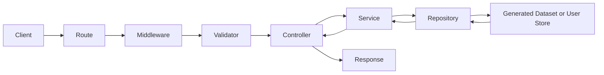

# Pokémon Companion Backend Architecture

> **Backend Architecture Specification**
>
> Defines the backend structure, dependency rules, data boundaries, runtime services, and development standards for Pokémon Companion.

---

## 1. Purpose

The Pokémon Companion backend provides a stable interface between:

- Generated canonical Pokémon datasets
- Context-aware application logic
- Dynamic maps and progression simulation
- User-owned adventure trackers
- Cloud synchronization
- Public and private APIs

The backend must remain independent of frontend implementation details and external Pokémon APIs at runtime.

Its primary responsibility is to expose validated Pokémon knowledge and safely manage personal trainer data.

---

## 2. Scope

This document defines:

- Backend project organization
- Layer responsibilities
- Dependency direction
- Request lifecycle
- Canonical data access
- User data access
- Context resolution
- Dynamic map services
- Progression simulation services
- Tracker isolation
- Validation and error handling
- Configuration, logging, performance, and security rules

This document does not define the complete API endpoint catalog, canonical database schema, data extraction pipeline, or frontend implementation.

---

## 3. Core Principles

### 3.1 Database-First Runtime

The backend consumes generated and validated local datasets.

It must not rely on live third-party Pokémon APIs for canonical runtime information.

```text
Generated Knowledge Datasets
        ↓
Repositories
        ↓
Services
        ↓
Controllers
        ↓
API Responses
```

### 3.2 Canonical Data Is Read-Only

Canonical Pokémon knowledge is immutable at runtime.

Backend services may query and transform canonical data but must never modify it.

Examples of read-only canonical data:

- Species
- Forms
- Pokémon
- Moves
- Abilities
- Items
- Maps
- Encounters
- Trainers
- Events
- Progression rules
- Assets

### 3.3 User Data Is Mutable and Isolated

User-owned data is mutable but must remain isolated by user and tracker.

Examples:

- Accounts
- Settings
- Adventure trackers
- Teams
- Pokémon instances
- Map progress
- Collection progress
- Notes
- Achievements

A tracker may reference canonical records but must never change them.

### 3.4 Context-Aware Results

Every historical result must be evaluated within a Game Context.

A request for FireRed data must not accidentally return LeafGreen, Emerald, or modern-game mechanics.

### 3.5 Service-Oriented Logic

Controllers coordinate HTTP input and output.

Services contain business logic.

Repositories provide data access.

No layer may bypass the layers beneath it.

---

## 4. Backend Structure

```text
backend/

├── config/
├── constants/
├── controllers/
├── middleware/
├── models/
├── repositories/
├── routes/
├── services/
├── utils/
├── validators/
├── jobs/
├── app.js
└── server.js
```

| Directory | Responsibility |
|---|---|
| `config/` | Environment, paths, feature flags, runtime configuration |
| `constants/` | Shared constants, enums, limits, error codes |
| `controllers/` | HTTP request and response coordination |
| `middleware/` | Authentication, authorization, logging, error handling |
| `models/` | Domain models for user-owned backend data |
| `repositories/` | Canonical and user data access |
| `routes/` | URL mapping and middleware registration |
| `services/` | Business logic and cross-repository coordination |
| `utils/` | Stateless reusable helpers |
| `validators/` | Request parameter, query, and body validation |
| `jobs/` | Background synchronization, indexing, and maintenance tasks |

---

## 5. Application Entry Points

### 5.1 `app.js`

`app.js` creates and configures the application.

Responsibilities:

- Create the HTTP application
- Register middleware
- Register route groups
- Configure centralized error handling
- Export the configured application

`app.js` must not start the network listener.

### 5.2 `server.js`

`server.js` starts and stops the server.

Responsibilities:

- Load configuration
- Start the HTTP server
- Report startup status
- Handle graceful shutdown
- Close database and file resources safely

---

## 6. Request Lifecycle

Every request follows the same lifecycle.



### 6.1 Lifecycle Rules

1. Routes map URLs to controllers.
2. Middleware applies reusable request behavior.
3. Validators reject invalid input before business logic runs.
4. Controllers invoke services.
5. Services apply business rules.
6. Repositories read or write storage.
7. Controllers return standardized responses.
8. Centralized middleware handles unexpected errors.

---

## 7. Dependency Rules

Dependencies must flow downward.

```text
Routes
    ↓
Controllers
    ↓
Services
    ↓
Repositories
    ↓
Storage
```

Allowed dependencies:

- Routes may import middleware, validators, and controllers.
- Controllers may import services and response utilities.
- Services may import repositories, domain models, and pure utilities.
- Repositories may import storage adapters and dataset utilities.
- Validators may import schemas and pure validation utilities.

Forbidden dependencies:

- Repositories must not import services or controllers.
- Services must not import controllers or routes.
- Validators must not execute business logic.
- Canonical repositories must not import user services.
- User repositories must not modify canonical datasets.
- Circular dependencies are prohibited.

---

## 8. Repository Architecture

Repositories hide storage details from services.

### 8.1 Canonical Repositories

Canonical repositories provide read-only access to generated knowledge datasets.

Examples:

```text
species-repository
pokemon-repository
move-repository
ability-repository
item-repository
location-repository
map-repository
encounter-repository
trainer-repository
event-repository
progression-rule-repository
asset-repository
```

Responsibilities:

- Load generated datasets
- Build and reuse lookup maps
- Resolve canonical identifiers
- Resolve context-specific records
- Return stable domain objects
- Avoid exposing storage paths to services

### 8.2 User Repositories

User repositories manage mutable personal data.

Examples:

```text
user-repository
tracker-repository
tracker-state-repository
pokemon-instance-repository
collection-repository
achievement-repository
sync-repository
```

Responsibilities:

- Enforce user ownership
- Enforce tracker isolation
- Persist state changes
- Return user-scoped records only
- Support synchronization metadata

### 8.3 Storage Adapters

Repositories should depend on storage adapters rather than a fixed database technology.

Possible adapters include:

- JSON datasets for canonical offline data
- SQLite for local user data
- PostgreSQL for cloud user data
- Object storage for assets
- IndexedDB for browser-local persistence

Storage may evolve without forcing service or controller rewrites.

---

## 9. Service Architecture

Services contain backend business logic.

### 9.1 Knowledge Services

| Service | Responsibilities |
|---|---|
| Pokémon Service | Pokémon, species, forms, abilities, moves, and evolutions |
| Search Service | Search, autocomplete, aliases, filters, and ranking |
| World Service | Regions, locations, maps, areas, and connections |
| Encounter Service | Wild encounters, gifts, fishing, trades, and version differences |
| Trainer Service | Trainers, parties, rematches, and battle metadata |
| Event Service | Story events, NPC events, items, gifts, and static encounters |
| Asset Service | Context-aware sprite, tile, model, and icon resolution |

### 9.2 Dynamic Map Services

| Service | Responsibilities |
|---|---|
| Map Service | Load maps, tiles, layers, objects, and connections |
| Map State Service | Merge canonical map objects with tracker progress |
| Map Interaction Service | Resolve object interaction state and valid tracker actions |
| Reachability Service | Calculate accessible maps, connections, objects, and areas |
| Exploration Service | Track discovery, item collection, trainer completion, and encounter discovery |

### 9.3 Progression Services

| Service | Responsibilities |
|---|---|
| Progression Service | Evaluate current progression state within a game context |
| Requirement Service | Resolve badges, HMs, items, events, and story requirements |
| Objective Service | Return available objectives and blocked objectives |
| Simulation Service | Evaluate hypothetical progress without changing tracker state |
| Developer Mode Service | Apply explicitly enabled glitch and debug rules |

### 9.4 Adventure Services

| Service | Responsibilities |
|---|---|
| Tracker Service | Create, update, archive, clone, and select trackers |
| Adventure State Service | Manage badges, field moves, location, key items, and story flags |
| Team Service | Manage party and box Pokémon instances |
| Collection Service | Manage seen, caught, owned, shiny, and item collection states |
| Achievement Service | Evaluate tracker achievement progress |
| Sync Service | Queue, merge, upload, and reconcile user changes |

---

## 10. Game Context Resolution

All canonical requests must resolve a Game Context before returning context-sensitive data.

```text
Request
    ↓
Version or Context Identifier
    ↓
Context Resolver
    ↓
Generation, Version Group, Version, Rule Set
    ↓
Context-Aware Repository Query
    ↓
Validated Result
```

Example:

```text
GET /contexts/firered/locations/celadon-city

Context Resolver:
context:firered

Result:
- FireRed map geometry
- FireRed encounters
- FireRed events
- FireRed trainer data
- FireRed progression requirements
```

Context resolution must reject unknown or unsupported contexts.

---

## 11. Dynamic Map Backend Behavior

The backend provides map data and interaction state. The frontend is responsible for visual rendering.

### 11.1 Map Response Composition

A dynamic-map response combines:

1. Canonical map geometry
2. Canonical map objects
3. Game-context rules
4. Tracker-specific progress
5. Current reachability evaluation

```json
{
    "mapId": "map:firered-celadon-city",
    "gameContextId": "context:firered",
    "trackerId": "tracker:firered-100",
    "layers": [],
    "objects": [],
    "accessibleConnections": [],
    "blockedConnections": [],
    "completion": {
        "itemsCollected": 3,
        "itemsTotal": 7,
        "trainersDefeated": 5,
        "trainersTotal": 8
    }
}
```

### 11.2 Map Object Actions

The backend validates tracker actions against the selected map object.

Examples:

- Mark an item as collected
- Mark a hidden item as discovered
- Mark a trainer as defeated
- Mark an NPC interaction as completed
- Mark a Pokémon as seen or caught
- Mark a static encounter as completed

The backend must confirm:

- The user owns the tracker.
- The map object exists in the tracker's game context.
- The requested state transition is valid.
- The action does not affect another tracker.

---

## 12. Progression Simulation Backend Behavior

The Progression Service must use a graph of explicit requirements rather than a fixed badge sequence.

### 12.1 Inputs

- Game Context
- Tracker badge state
- Field move state
- Key items
- Story flags
- Completed events
- Cleared obstacles
- Enabled developer options
- Optional hypothetical simulation state

### 12.2 Outputs

- Accessible locations
- Accessible map connections
- Available events
- Available trainers
- Available items
- Available encounters
- Available objectives
- Blocked objectives and their requirements

```json
{
    "gameContextId": "context:firered",
    "mode": "normal",
    "accessibleLocationIds": [],
    "availableObjectiveIds": [],
    "blockedObjectives": [
        {
            "objectiveId": "objective:firered-enter-saffron",
            "missingRequirements": [
                "item:tea"
            ]
        }
    ]
}
```

### 12.3 Simulation Mode

Simulation Mode accepts hypothetical state changes but must never persist them.

```text
Saved Tracker State
        ≠
Simulation State
```

A simulation request may ask:

> If this tracker had the Cascade Badge, Cut, and Tea, what would become reachable?

The result is read-only unless the user separately applies changes to the tracker.

---

## 13. Normal Mode and Developer Mode

### 13.1 Normal Mode

Normal Mode is the default progression ruleset.

It supports:

- Intended gameplay
- Context-accurate mechanics
- Legitimate alternate routes
- Optional locations
- Non-glitch sequence breaks

### 13.2 Developer Mode

Developer Mode is opt-in and supports:

- Verified glitches
- Debug states
- Test field moves
- Forced events
- Full map preview
- Advanced route analysis

Developer Mode must never silently alter Normal Mode results.

Every developer-only result should identify the enabled glitch or override that made it available.

---

## 14. User Data and Tracker Isolation

Every write operation must enforce both user ownership and tracker ownership.

```text
Authenticated User
        ↓
Requested Tracker
        ↓
Ownership Validation
        ↓
Tracker-Scoped Service
        ↓
Tracker-Scoped Repository Write
```

Required rules:

1. A tracker belongs to exactly one user.
2. Every adventure-state record belongs to exactly one tracker.
3. Every Pokémon instance belongs to exactly one tracker.
4. A tracker may use only one selected game context at a time.
5. One tracker cannot inherit progress from another tracker automatically.
6. A FireRed tracker and a LeafGreen tracker are always independent.
7. Two FireRed trackers are always independent.

---

## 15. Validation Flow

Incoming requests are validated before reaching services.

### 15.1 Request Validation

Validators check:

- Route parameters
- Context identifiers
- Entity identifiers
- Pagination
- Filters
- Sort fields
- Request body shape
- User ownership
- Tracker ownership
- Allowed state transitions

### 15.2 Domain Validation

Services validate:

- Context compatibility
- Requirement satisfaction
- Tracker mode restrictions
- Map object availability
- Event transitions
- Duplicate collection actions
- Developer-mode permissions

### 15.3 Repository Validation

Repositories validate:

- Record existence
- Storage integrity
- Identifier consistency
- Context reference resolution
- User and tracker scope

---

## 16. Response Standards

Successful responses use a consistent structure.

```json
{
    "success": true,
    "data": {},
    "meta": {}
}
```

Error responses use a consistent structure.

```json
{
    "success": false,
    "error": {
        "code": "RESOURCE_NOT_FOUND",
        "message": "The requested resource does not exist."
    }
}
```

Responses may include metadata for:

- Pagination
- Context
- Build version
- Dataset version
- Warnings
- Simulation mode
- Developer-mode status

---

## 17. Error Handling

Errors must be handled centrally through error middleware.

Error responses must:

- Use appropriate HTTP status codes
- Avoid exposing internal implementation details
- Include a stable error code
- Include a meaningful user-safe message
- Be logged with diagnostic context
- Support future localization

Typical error categories:

```text
VALIDATION_ERROR
AUTHENTICATION_REQUIRED
AUTHORIZATION_DENIED
RESOURCE_NOT_FOUND
CONTEXT_NOT_SUPPORTED
TRACKER_NOT_FOUND
TRACKER_ACCESS_DENIED
INVALID_STATE_TRANSITION
DATASET_UNAVAILABLE
INTERNAL_ERROR
```

---

## 18. Configuration Management

Configuration must remain centralized.

Examples:

- HTTP port
- Environment mode
- Dataset paths
- User database connection
- Asset storage paths
- API version
- Sync settings
- Authentication settings
- Rate limits
- Feature flags
- Developer-mode availability

Configuration must not be duplicated across controllers, services, or repositories.

Secrets must never be committed to source control.

---

## 19. Logging and Observability

Logging must be centralized and structured.

Log categories:

- `info`
- `warning`
- `error`
- `debug`
- `audit`

Important backend events include:

- Server startup and shutdown
- Dataset version loaded
- Validation failures
- Authentication failures
- Tracker writes
- Synchronization conflicts
- Unexpected errors
- Background job failures

User-sensitive information must not be written to logs unnecessarily.

---

## 20. Performance Principles

The backend should provide predictable performance without weakening historical correctness.

Recommendations:

- Build lookup maps once and reuse them.
- Avoid repeated dataset loading.
- Use repository-level caching for immutable canonical data.
- Load only the required context-specific records.
- Pre-generate expensive relationship and search indexes.
- Cache progression calculations only when tracker state is included in the cache key.
- Avoid exposing unnecessary map layers or assets by default.
- Paginate large lists.

Performance optimizations must preserve context correctness and tracker isolation.

---

## 21. Security Principles

The backend must use secure defaults.

Required practices:

- Authenticate all private user-data requests.
- Authorize every tracker mutation.
- Validate all input.
- Sanitize untrusted text.
- Rate-limit public endpoints where appropriate.
- Use secure HTTP headers.
- Store secrets only in environment configuration.
- Log security-relevant events.
- Keep canonical datasets read-only at runtime.
- Support recoverable deletion for user data where practical.

---

## 22. Future Expansion

The backend architecture supports future additions through new services, repositories, and storage adapters.

Planned capabilities include:

- Account authentication
- Cloud synchronization
- WebSocket updates
- Background jobs
- Notifications
- Save-file imports
- OCR-assisted progress detection
- AI companion services
- Community routes
- Shared challenges
- Advanced analytics
- Multiple local and cloud storage providers

New features should extend the existing dependency flow rather than bypassing it.

---

## 23. Final Architecture Summary

```text
Generated Canonical Datasets
            ↓
      Canonical Repositories
            ↓
       Context-Aware Services
            ↓
Controllers and API Responses
            ↓
Frontend Applications

User Database
            ↓
User Repositories
            ↓
Tracker and Sync Services
            ↓
Authenticated User APIs
```

The backend exists to expose historically accurate Pokémon knowledge, dynamic exploration data, and isolated trainer progress through a predictable, modular, and secure architecture.