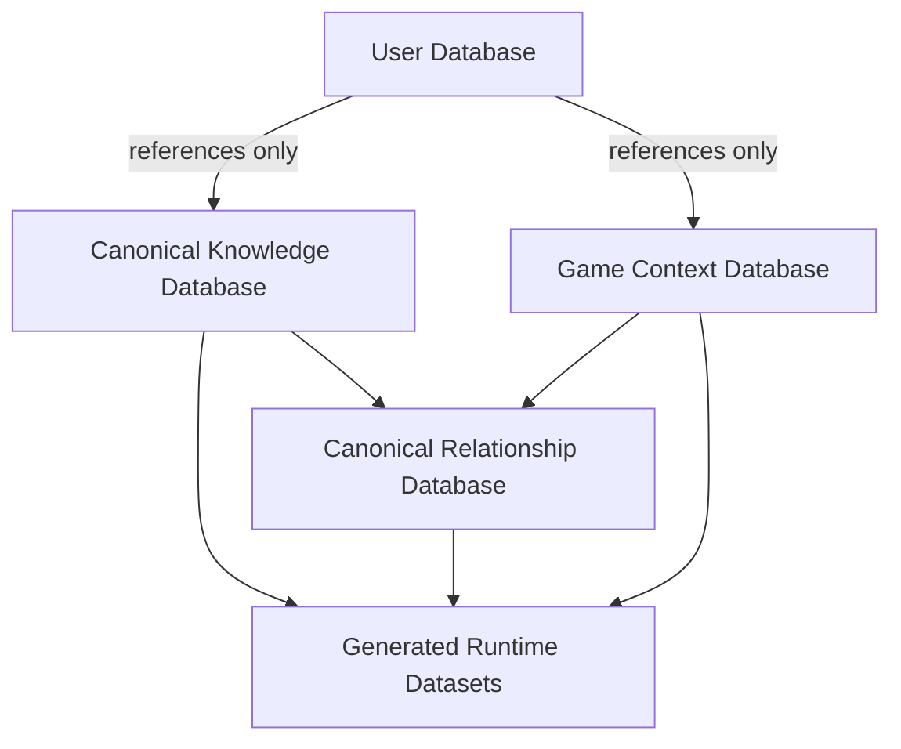

# Pokémon Companion Database Schema

> **Canonical Knowledge Graph and User Data Schema**
>
> Defines the entities, relationships, contexts, identifiers, and state boundaries used by Pokémon Companion.

---

## 1. Purpose

The Pokémon Companion database is a version-aware knowledge graph designed to represent official Pokémon games accurately while supporting interactive maps, progression simulation, adventure trackers, and future platform features.

This document defines:

- Canonical entities
- Relationship entities
- Game and rule contexts
- Dynamic map and progression records
- User-owned tracker records
- Identifier rules
- Ownership boundaries
- Generated dataset rules

The schema defines **what the data represents**. The Data Architecture document defines how that data is extracted, normalized, validated, generated, and delivered to the application.

---

## 2. Schema Principles

### 2.1 Canonical First

Every real-world Pokémon concept has one canonical record.

Examples:

- One Species record for Pikachu
- One Move record for Thunderbolt
- One Ability record for Static
- One Item record for Potion
- One Location record for Cerulean City

Canonical entities must not be duplicated for each game.

Historical differences are represented through contexts and relationships.

### 2.2 Relationship Driven

Relationships are first-class records.

A relationship may contain:

- Source and target identifiers
- Game context
- Version applicability
- Method
- Conditions
- Probability
- Level
- Availability
- Restrictions
- Notes
- Provenance

For example, a Pokémon learning a move is not an anonymous nested object. It is a version-aware `pokemon-learns-move` relationship.

### 2.3 Context Aware

All historical information is interpreted through a Game Context.

A context determines which entities, relationships, mechanics, maps, events, encounters, and progression rules apply.

### 2.4 User Data Is Separate

Canonical data describes official Pokémon knowledge.

User data describes an individual's adventure, collection, progress, and preferences.

User data references canonical records but never modifies them.

### 2.5 Generated Data Is Replaceable

Search indexes, lookup maps, encounter tables, map reachability indexes, and evolution graphs are generated views.

They are not source-of-truth records and must be reproducible from canonical data.

---

## 3. Database Domains



| Domain | Purpose | Mutable at Runtime |
|---|---|---|
| Canonical Knowledge | Official Pokémon entities | No |
| Canonical Relationships | Official version-aware relationships | No |
| Game Contexts | Rules for specific games and modes | No |
| Generated Datasets | Optimized runtime views | No |
| User Database | Accounts, trackers, progress, collections, settings | Yes |

---

## 4. Identifier Standards

Every record has a permanent canonical identifier.

Identifiers must:

- Be globally unique
- Be stable
- Never be reused
- Be independent of display names
- Use lowercase kebab-case where text is required
- Be suitable for references, APIs, validation, and generated datasets

### 4.1 Identifier Format

```text
entity-type:entity-key
```

Examples:

```text
generation:1
version-group:firered-leafgreen
version:firered
context:firered

species:pikachu
form:charizard-mega-x
pokemon:pikachu-default

move:thunderbolt
ability:static
item:tea

region:kanto
location:celadon-city
map:firered-celadon-city
map-object:firered-celadon-eevee

trainer:firered-brock
event:firered-obtain-poke-flute
encounter:firered-route-1-grass

relationship:pokemon-learns-move:000001
tracker:firered-100
```

### 4.2 Display Names

Display names are presentation data and must never be used as foreign keys.

Examples:

```text
Mr. Mime
Farfetch'd
Type: Null
Pokémon HOME
Pokémon GO
```

---

## 5. Entity Categories

Every record belongs to one primary category.

```text
Knowledge Graph
├── Canonical Entities
├── Relationship Entities
├── Context Entities
├── Map and Progression Entities
├── Asset Entities
├── Generated Datasets
└── User Entities
```

---

## 6. Common Record Metadata

All canonical and relationship records should support the following metadata.

```json
{
    "id": "entity-type:entity-key",
    "schemaVersion": 1,
    "source": {
        "sourceId": "source:official-game-data",
        "extractionMethod": "structured-extraction",
        "verificationStatus": "verified",
        "verifiedAt": "2026-08-16T00:00:00Z"
    },
    "createdAt": "2026-08-16T00:00:00Z",
    "updatedAt": "2026-08-16T00:00:00Z"
}
```

Required provenance fields:

| Field | Purpose |
|---|---|
| `sourceId` | Identifies the original source |
| `extractionMethod` | Describes how the data was obtained |
| `verificationStatus` | Indicates confidence and review status |
| `buildVersion` | Identifies the build that generated the record |
| `verifiedAt` | Records the latest validation or review date |

---

## 7. Game Context Entities

### 7.1 Generation

A Generation represents a major era of mechanics.

```json
{
    "id": "generation:3",
    "number": 3,
    "name": "Generation III",
    "releasePeriod": {
        "startYear": 2002,
        "endYear": 2006
    }
}
```

### 7.2 Version Group

A Version Group represents games that share most mechanics and data.

Examples:

- Red / Blue
- Gold / Silver
- Ruby / Sapphire
- FireRed / LeafGreen
- Scarlet / Violet

```json
{
    "id": "version-group:firered-leafgreen",
    "generationId": "generation:3",
    "name": "FireRed / LeafGreen",
    "versionIds": [
        "version:firered",
        "version:leafgreen"
    ]
}
```

### 7.3 Version

A Version represents one official release.

```json
{
    "id": "version:firered",
    "versionGroupId": "version-group:firered-leafgreen",
    "generationId": "generation:3",
    "name": "Pokémon FireRed",
    "platform": "Game Boy Advance",
    "releaseDate": "2004-09-09"
}
```

### 7.4 Game Context

A Game Context defines the rules used to interpret the knowledge graph.

```json
{
    "id": "context:firered",
    "versionId": "version:firered",
    "versionGroupId": "version-group:firered-leafgreen",
    "generationId": "generation:3",
    "ruleSetId": "rule-set:firered-standard",
    "enabledFeatures": [
        "feature:field-moves",
        "feature:trainer-battles",
        "feature:story-events"
    ]
}
```

A Game Context determines:

- Available Pokémon
- Available forms
- Available moves
- Available abilities
- Available items
- Available encounters
- Available trainers
- Available maps
- Available events
- Available mechanics
- Available progression rules

---

## 8. Canonical Pokémon Entities

### 8.1 Species

A Species represents a biological Pokémon species independent of form or game.

```json
{
    "id": "species:pikachu",
    "nationalDexNumber": 25,
    "name": "Pikachu",
    "introducedGenerationId": "generation:1"
}
```

Species-level information may include:

- National Dex number
- Name
- Introduced generation
- Evolution family reference
- Form family reference
- Canonical classification

### 8.2 Form

A Form represents a recognized variation of a species.

Examples:

- Charizard Mega X
- Alolan Rattata
- Hisuian Samurott
- Gigantamax Charizard
- Unown B

```json
{
    "id": "form:charizard-mega-x",
    "speciesId": "species:charizard",
    "name": "Charizard Mega X",
    "formKind": "mega",
    "introducedGenerationId": "generation:6"
}
```

Form kinds include:

- `regional`
- `mega`
- `primal`
- `gigantamax`
- `battle-only`
- `cosmetic`
- `alternate`
- `special`

### 8.3 Pokémon

A Pokémon record represents a battle-capable default or specific form representation.

```json
{
    "id": "pokemon:pikachu-default",
    "speciesId": "species:pikachu",
    "formId": null,
    "defaultForm": true
}
```

Pokémon properties that vary by context, including types, base stats, and abilities, are stored through contextual relationships or snapshots.

### 8.4 Type

```json
{
    "id": "type:electric",
    "name": "Electric",
    "introducedGenerationId": "generation:1"
}
```

### 8.5 Move

```json
{
    "id": "move:thunderbolt",
    "name": "Thunderbolt",
    "introducedGenerationId": "generation:1"
}
```

### 8.6 Ability

```json
{
    "id": "ability:static",
    "name": "Static",
    "introducedGenerationId": "generation:3"
}
```

### 8.7 Item

```json
{
    "id": "item:tea",
    "name": "Tea",
    "introducedGenerationId": "generation:3",
    "itemKind": "key-item"
}
```

### 8.8 Supporting Entities

Additional canonical Pokémon entities include:

- Nature
- Egg Group
- Evolution Method
- Machine
- Pokédex Entry
- Ribbon
- Mark
- Move Target
- Damage Class
- Contest Type

---

## 9. World Entities

### 9.1 Region

```json
{
    "id": "region:kanto",
    "name": "Kanto"
}
```

### 9.2 Location

A Location is a named in-world place.

```json
{
    "id": "location:celadon-city",
    "regionId": "region:kanto",
    "name": "Celadon City",
    "locationKind": "city"
}
```

Location kinds include:

- `city`
- `town`
- `route`
- `cave`
- `forest`
- `tower`
- `building`
- `island`
- `sea-route`
- `special-area`

### 9.3 Location Area

A Location Area is a logical sub-area used for encounters, events, or map connections.

```json
{
    "id": "location-area:celadon-city-west",
    "locationId": "location:celadon-city",
    "name": "Celadon City West"
}
```

### 9.4 Map

A Map is a context-specific tile representation.

```json
{
    "id": "map:firered-celadon-city",
    "gameContextId": "context:firered",
    "locationId": "location:celadon-city",
    "width": 40,
    "height": 36,
    "tileSetId": "tile-set:firered-overworld"
}
```

Maps may be shared by related games only when geometry and behavior are confirmed equivalent.

### 9.5 Map Tile

A Map Tile represents a tile coordinate and its properties.

```json
{
    "id": "map-tile:firered-celadon-city-12-7",
    "mapId": "map:firered-celadon-city",
    "x": 12,
    "y": 7,
    "terrainType": "grass",
    "collision": false,
    "layers": [
        "terrain",
        "object"
    ]
}
```

---

## 10. Dynamic Map Entities

### 10.1 Map Object

Every interactable map object is a canonical, version-aware record.

```json
{
    "id": "map-object:firered-celadon-eevee",
    "gameContextId": "context:firered",
    "mapId": "map:firered-celadon-mansion-roof",
    "objectType": "gift-pokemon",
    "position": {
        "x": 12,
        "y": 7
    },
    "assetId": "asset:sprite:eevee",
    "eventId": "event:firered-receive-eevee"
}
```

Object types include:

- `npc`
- `trainer`
- `visible-item`
- `hidden-item`
- `gift-pokemon`
- `static-encounter`
- `obstacle`
- `warp`
- `sign`
- `story-event`
- `map-connection`

### 10.2 Map Connection

A Map Connection links maps or locations.

```json
{
    "id": "map-connection:firered-route-7-saffron-gate",
    "gameContextId": "context:firered",
    "fromMapId": "map:firered-route-7",
    "toMapId": "map:firered-saffron-city",
    "connectionType": "gate",
    "requirementSetId": "requirement-set:firered-saffron-tea"
}
```

### 10.3 Obstacle

An Obstacle represents a physical or story-based barrier.

```json
{
    "id": "obstacle:firered-route-12-snorlax",
    "gameContextId": "context:firered",
    "mapId": "map:firered-route-12",
    "obstacleType": "static-pokemon",
    "requirementSetId": "requirement-set:firered-poke-flute",
    "eventId": "event:firered-route-12-snorlax"
}
```

Obstacle types include:

- `cut-tree`
- `surf-water`
- `strength-boulder`
- `rock-smash-rock`
- `static-pokemon`
- `guard`
- `story-lock`
- `event-lock`
- `one-way-barrier`

---

## 11. Progression Entities

### 11.1 Requirement Set

A Requirement Set defines the conditions required to access a map connection, event, objective, or object.

```json
{
    "id": "requirement-set:firered-saffron-tea",
    "operator": "all",
    "requirements": [
        {
            "type": "key-item",
            "entityId": "item:tea"
        }
    ]
}
```

Supported requirement types include:

- `badge`
- `field-move`
- `move`
- `key-item`
- `item`
- `story-flag`
- `event`
- `trainer-defeat`
- `pokemon-state`
- `location-visit`
- `developer-setting`
- `glitch-enabled`

### 11.2 Progression Rule

A Progression Rule describes one context-specific rule.

```json
{
    "id": "progression-rule:firered-use-cut",
    "gameContextId": "context:firered",
    "ruleType": "field-move-permission",
    "subjectId": "move:cut",
    "requirementSetId": "requirement-set:firered-cascade-badge"
}
```

### 11.3 Objective

An Objective is a discoverable or recommended action, not a forced linear step.

```json
{
    "id": "objective:firered-obtain-tea",
    "gameContextId": "context:firered",
    "objectiveType": "key-item",
    "entityId": "item:tea",
    "requirementSetId": "requirement-set:firered-reach-celadon",
    "locationId": "location:celadon-city"
}
```

### 11.4 Progression Mode

Progression modes are explicit rule sets.

```text
rule-set:firered-standard
rule-set:firered-developer
```

| Mode | Purpose |
|---|---|
| Normal Mode | Intended rules and legitimate non-glitch alternatives |
| Developer Mode | Verified glitches, debug states, testing, and advanced route planning |

Developer-mode routes must remain separate from normal progression results.

---

## 12. Gameplay Relationship Entities

### 12.1 Pokémon Has Type

```json
{
    "id": "relationship:pokemon-has-type:pikachu-electric",
    "pokemonId": "pokemon:pikachu-default",
    "typeId": "type:electric",
    "gameContextId": "context:firered",
    "slot": 1
}
```

### 12.2 Pokémon Has Ability

```json
{
    "id": "relationship:pokemon-has-ability:pikachu-static",
    "pokemonId": "pokemon:pikachu-default",
    "abilityId": "ability:static",
    "gameContextId": "context:firered",
    "slot": 1,
    "hidden": false
}
```

### 12.3 Pokémon Learns Move

```json
{
    "id": "relationship:pokemon-learns-move:000001",
    "pokemonId": "pokemon:pikachu-default",
    "moveId": "move:thunderbolt",
    "gameContextId": "context:firered",
    "method": "machine",
    "machineId": "machine:tm24",
    "requirements": []
}
```

### 12.4 Evolution Relationship

```json
{
    "id": "relationship:pokemon-evolves:pikachu-raichu",
    "fromPokemonId": "pokemon:pikachu-default",
    "toPokemonId": "pokemon:raichu-default",
    "gameContextId": "context:firered",
    "methodId": "evolution-method:use-item",
    "itemId": "item:thunder-stone",
    "requirements": []
}
```

### 12.5 Encounter Relationship

```json
{
    "id": "encounter:firered-route-1-grass-pidgey",
    "gameContextId": "context:firered",
    "locationAreaId": "location-area:route-1-grass",
    "pokemonId": "pokemon:pidgey-default",
    "method": "walk",
    "levelRange": {
        "minimum": 2,
        "maximum": 5
    },
    "probability": 50
}
```

### 12.6 Trainer Party Relationship

```json
{
    "id": "trainer-party:firered-brock",
    "trainerId": "trainer:firered-brock",
    "gameContextId": "context:firered",
    "members": [
        {
            "pokemonId": "pokemon:geodude-default",
            "level": 12
        },
        {
            "pokemonId": "pokemon:onix-default",
            "level": 14
        }
    ]
}
```

---

## 13. Asset Entities

Assets are canonical references to visual resources.

```json
{
    "id": "asset:sprite:pikachu-front-default",
    "assetType": "pokemon-sprite",
    "subjectId": "pokemon:pikachu-default",
    "variant": "front-default",
    "gameContextId": "context:firered",
    "filePath": "assets/sprites/pokemon/pikachu/front-default.png"
}
```

Asset types include:

- `pokemon-sprite`
- `trainer-sprite`
- `npc-sprite`
- `item-sprite`
- `map-tile`
- `map-object`
- `badge`
- `medal`
- `icon`
- `model`
- `animation`

---

## 14. User Database Schema

The User Database contains mutable personal information.

It must remain separate from canonical and generated knowledge data.

### 14.1 User

```json
{
    "id": "user:krishan",
    "username": "Krishan",
    "settings": {
        "theme": "system",
        "offlineModeEnabled": true
    }
}
```

### 14.2 Adventure Tracker

```json
{
    "id": "tracker:firered-100",
    "userId": "user:krishan",
    "gameContextId": "context:firered",
    "name": "FireRed 100%",
    "mode": "normal",
    "createdAt": "2026-08-16T00:00:00Z",
    "updatedAt": "2026-08-16T00:00:00Z"
}
```

A user may create unlimited trackers, including multiple trackers for the same game context.

### 14.3 Tracker State

```json
{
    "trackerId": "tracker:firered-100",
    "currentLocationId": "location:celadon-city",
    "badges": [
        "badge:boulder",
        "badge:cascade"
    ],
    "fieldMoves": [
        "move:cut"
    ],
    "keyItems": [
        "item:tea"
    ],
    "completedEventIds": [
        "event:firered-rescue-bill"
    ],
    "settings": {
        "developerMode": false,
        "glitchRoutesEnabled": false
    }
}
```

### 14.4 Tracker Map State

```json
{
    "trackerId": "tracker:firered-100",
    "visitedLocationIds": [
        "location:pallet-town",
        "location:viridian-city"
    ],
    "collectedMapObjectIds": [
        "map-object:firered-route-1-potion"
    ],
    "defeatedTrainerIds": [
        "trainer:firered-brock"
    ],
    "clearedObstacleIds": [],
    "discoveredEncounterIds": []
}
```

### 14.5 Pokémon Instance

A Pokémon Instance represents a Pokémon owned by a user.

```json
{
    "id": "pokemon-instance:001",
    "trackerId": "tracker:firered-100",
    "pokemonId": "pokemon:pikachu-default",
    "nickname": "Spark",
    "level": 25,
    "natureId": "nature:timid",
    "abilityId": "ability:static",
    "ivs": {},
    "evs": {},
    "moveIds": [
        "move:thunderbolt"
    ],
    "originalTrainer": "Krishan",
    "pokeballItemId": "item:poke-ball",
    "shiny": false,
    "ribbonIds": [],
    "markIds": []
}
```

### 14.6 Collection State

Collection state records user progress without changing canonical records.

Examples:

- Seen Pokémon
- Caught Pokémon
- Owned Pokémon
- Shiny Pokémon
- Collected items
- Defeated trainers
- Completed locations
- Discovered encounters

### 14.7 Achievement State

```json
{
    "trackerId": "tracker:firered-100",
    "achievementId": "achievement:route-explorer",
    "progress": 12,
    "target": 50,
    "status": "in-progress"
}
```

---

## 15. Tracker Isolation Rules

The following rule is mandatory:

> No tracker may read, inherit, modify, or display progress from another tracker unless the user explicitly performs an export, import, clone, or comparison action.

This applies even when trackers use:

- The same game
- The same game context
- The same user account
- The same device
- The same cloud account

Examples:

```text
FireRed 100%      → Separate state
FireRed Nuzlocke  → Separate state
LeafGreen Casual  → Separate state
Emerald Living Dex → Separate state
```

---

## 16. Generated Dataset Rules

Generated datasets may include:

- `pokemon-index.json`
- `move-lookup.json`
- `ability-lookup.json`
- `item-lookup.json`
- `evolution-graph.json`
- `encounter-tables.json`
- `map-connection-index.json`
- `progression-rule-index.json`
- `search-index.json`
- `autocomplete-index.json`

Every generated dataset must:

- Be deterministic
- Be reproducible
- Reference canonical identifiers
- Preserve game context
- Pass validation
- Contain no manual edits
- Be replaceable without data loss

---

## 17. Validation Requirements

### 17.1 Entity Validation

- Identifier format is valid
- Identifier is unique
- Required fields exist
- Property types are valid
- Enumerations are valid
- Source metadata exists
- Context references resolve

### 17.2 Relationship Validation

- Both endpoints exist
- Relationship type is valid
- Context exists
- Requirements resolve
- Duplicate relationships are prohibited
- Historical applicability is valid

### 17.3 Map Validation

- Map coordinates are valid
- Object positions are inside map bounds
- Connections reference existing maps
- Requirement sets resolve
- Obstacles reference valid events or requirements
- Asset references resolve

### 17.4 Progression Validation

- Every requirement references an existing canonical record
- Context rules do not activate impossible mechanics
- Normal Mode excludes glitch-only routes
- Developer Mode routes are explicitly marked
- Reachability graphs contain no invalid dead references

### 17.5 User Data Validation

- Tracker owner exists
- Tracker context exists
- Pokémon instances belong to the tracker
- Map progress references valid map objects
- Collection references valid canonical entities
- Tracker state cannot reference another tracker's records

---

## 18. Future Expansion

The schema is designed to support future additions without redesigning existing records.

Planned expansion areas include:

- Additional official Pokémon games
- New regions and map systems
- DLC and event contexts
- More detailed tile and collision data
- Save-file import
- OCR-assisted progress detection
- AI companion features
- Community routes and challenges
- Research contributions
- Pokémon HOME integration where technically and legally feasible

New features should add canonical entities, relationships, contexts, or generated datasets while preserving existing identifiers and historical records.

---

## 19. Final Schema Summary

```text
Canonical Entities
    ↓
Version-Aware Relationships
    ↓
Game Contexts
    ↓
Maps, Events, and Progression Rules
    ↓
Generated Runtime Datasets
    ↓
Application Runtime

User Accounts
    ↓
Independent Adventure Trackers
    ↓
Tracker State, Map State, Collections, Teams, Achievements
    ↓
Optional Cloud Synchronization
```

The Pokémon Companion schema provides a stable foundation for a historically accurate Pokémon knowledge graph, dynamic map exploration, non-linear progression simulation, and completely isolated multi-adventure user tracking.