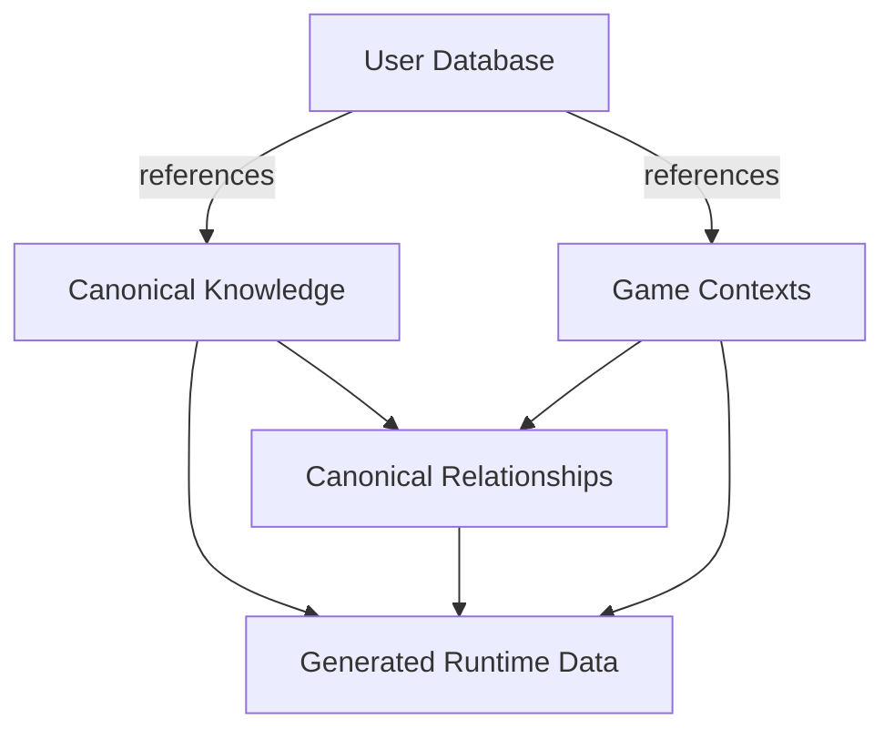

# Pokémon Companion Database Schema

> **Canonical Knowledge Graph and User Data Schema**
>
> Defines the entities, relationships, contexts, identifiers, and state boundaries used by Pokémon Companion.
>
> **Scope:** This document defines the logical database/schema model. It does not replace `DATA_ARCHITECTURE.md`, which defines the broader extraction, normalization, validation, generation, and runtime data architecture.

---

## 1. Purpose

The Pokémon Companion database is a version-aware knowledge graph designed to represent official Pokémon games accurately while supporting:

- Interactive maps
- Progression simulation
- Adventure trackers
- Pokédex and collection systems
- Search and cross-reference features
- Future AI features

This document defines:

- Canonical entities
- Context entities
- Relationship records
- World and map records
- Progression records
- User-owned records
- Identifier conventions
- Ownership boundaries
- Generated dataset contracts
- Validation expectations

The schema defines **what data represents**. The Data Architecture defines **how that data moves through the system**.

---

## 2. Schema Principles

### 2.1 Canonical First

Every canonical Pokémon concept should have one authoritative record.

Examples:

- One Species record for Pikachu
- One Move record for Thunderbolt
- One Ability record for Static
- One Item record for Potion
- One Location record for Cerulean City

Historical differences belong in context-specific state or relationships.

### 2.2 Relationship Driven

Relationships represent connections between canonical concepts.

For example:

```text
Species -> Form
Pokémon -> Move
Move -> Machine
Location -> Encounter
Trainer -> Party
Event -> Requirement
```

A relationship may contain context, method, level, probability, conditions, or other metadata.

### 2.3 Context Aware

Historical information must be interpretable through a Game Context.

A context determines which rules and relationships apply to a particular game or supported mode.

### 2.4 User Data Is Separate

Canonical data describes Pokémon knowledge.

User data describes an individual's adventure.

User records may reference canonical IDs but must not modify canonical records.

### 2.5 Generated Data Is Replaceable

Indexes and optimized runtime datasets are derived views.

They can be deleted and regenerated from canonical data.

They are never an independent source of truth.

---

## 3. Database Domains



| Domain | Purpose | Runtime Mutable |
|---|---|---|
| Canonical Knowledge | Official Pokémon concepts | No |
| Canonical Relationships | Connections and historical applicability | No |
| Game Contexts | Game-specific interpretation | No |
| Generated Data | Optimized runtime views | No |
| User Database | Accounts, trackers, progress, collections | Yes |

---

## 4. Record Ownership

Every field should have a clear owner.

| Information | Owner |
|---|---|
| Species identity | Species |
| Move identity | Move |
| Pokémon learns Move | Learnset relationship |
| Move availability in a game | Context relationship/state |
| Encounter location | Encounter relationship |
| User caught Pokémon | User tracker |
| Map reachability | Generated/runtime view |
| User visited location | Tracker state |
| Search index | Generated dataset |
| User nickname | Pokémon instance |

A record must not copy another record's responsibility merely for convenience.

---

## 5. Common Record Metadata

Canonical records and relationship records should support provenance where appropriate.

```json
{
    "schemaVersion": 1,
    "source": {
        "sourceId": "source:official-game-data",
        "extractionMethod": "structured-extraction",
        "verificationStatus": "verified",
        "verifiedAt": "2026-08-16T00:00:00Z"
    }
}
```

Recommended metadata:

| Field | Purpose |
|---|---|
| `schemaVersion` | Schema interpretation |
| `sourceId` | Original source |
| `extractionMethod` | How data was obtained |
| `verificationStatus` | Validation/review state |
| `verifiedAt` | Latest verification time |
| `buildVersion` | Dataset build that produced the record |

`createdAt` and `updatedAt` may be used for operational metadata, but they do not define canonical identity.

---

# 6. Identifier Standards

Identifiers are permanent references to canonical records.

## 6.1 Rules

Identifiers must:

- Be unique within their entity namespace
- Remain stable
- Never be reused for an unrelated concept
- Be independent of display names
- Be safe for JSON and API usage
- Use lowercase kebab-case keys where applicable

Preferred format:

```text
entity-type:entity-key
```

Examples:

```text
species:charizard
form:charizard-mega-x
pokemon:charizard-default

move:flamethrower
ability:blaze
item:tea

generation:3
game:firered
version-group:firered-leafgreen
version:firered
context:firered

region:kanto
location:celadon-city
location-area:route-1-grass
map:firered-celadon-city

trainer:firered-brock
event:firered-obtain-poke-flute
```

## 6.2 Display Names Are Not IDs

These are presentation values:

```text
Charizard
Flamethrower
Mr. Mime
Farfetch'd
```

They must not be used as canonical foreign keys.

---

# 7. Game Context Model

The game context hierarchy is:

```text
Generation
    ↓
Game
    ↓
Version Group
    ↓
Version
    ↓
Game Context
```

These concepts are related but are not interchangeable.

---

## 7.1 Generation

A Generation represents a major historical era.

```json
{
    "id": "generation:3",
    "number": 3,
    "name": "Generation III",
    "releasePeriod": {
        "startYear": 2002,
        "endYear": 2006
    }
}
```

Generation provides broad historical context but does not define all game-specific behavior.

---

## 7.2 Game

A Game represents an official Pokémon title.

Examples:

```text
game:red
game:blue
game:yellow
game:crystal
game:emerald
game:firered
game:platinum
game:black-2
game:x
game:ultra-moon
game:sword
game:legends-arceus
game:scarlet
```

Each title receives an independent stable identity.

---

## 7.3 Version Group

A Version Group groups releases that share a substantial common ruleset.

Examples:

```text
version-group:red-blue
version-group:ruby-sapphire
version-group:firered-leafgreen
version-group:scarlet-violet
```

A Version Group must not erase version-specific differences.

---

## 7.4 Version

A Version represents a specific release variant.

```json
{
    "id": "version:firered",
    "gameId": "game:firered",
    "versionGroupId": "version-group:firered-leafgreen",
    "generationId": "generation:3",
    "name": "Pokémon FireRed",
    "platform": "Game Boy Advance"
}
```

Version-specific records may include:

- Encounters
- Trainers
- Items
- Events
- Version exclusives
- Story differences
- Map differences

---

## 7.5 Game Context

A Game Context is the primary runtime context for resolving historical data.

```json
{
    "id": "context:firered",
    "gameId": "game:firered",
    "versionId": "version:firered",
    "versionGroupId": "version-group:firered-leafgreen",
    "generationId": "generation:3",
    "ruleSetId": "rule-set:firered-standard"
}
```

A Game Context may resolve:

- Available Pokémon
- Forms
- Moves
- Abilities
- Items
- Encounters
- Trainers
- Maps
- Events
- Mechanics
- Progression rules

Backend services should resolve context before answering historical questions.

---

# 8. Canonical Pokémon Entities

## 8.1 Species

A Species represents the underlying canonical species.

```json
{
    "id": "species:pikachu",
    "nationalDexNumber": 25,
    "name": "Pikachu",
    "introducedGenerationId": "generation:1"
}
```

Species identity does not change between games.

---

## 8.2 Form

A Form represents an official variation of a Species.

```json
{
    "id": "form:charizard-mega-x",
    "speciesId": "species:charizard",
    "name": "Charizard Mega X",
    "formKind": "mega",
    "introducedGenerationId": "generation:6"
}
```

Common form kinds:

```text
regional
mega
primal
gigantamax
battle-only
cosmetic
alternate
special
```

A Form references its parent Species instead of duplicating Species data.

---

## 8.3 Pokémon

The Pokémon entity represents a canonical battle-capable representation used by the application.

```json
{
    "id": "pokemon:pikachu-default",
    "speciesId": "species:pikachu",
    "formId": null,
    "isDefault": true
}
```

Context-dependent properties such as stats, types, abilities, and learnsets are not assumed to be universal.

---

## 8.4 Type

```json
{
    "id": "type:electric",
    "name": "Electric",
    "introducedGenerationId": "generation:1"
}
```

---

## 8.5 Move

```json
{
    "id": "move:thunderbolt",
    "name": "Thunderbolt",
    "introducedGenerationId": "generation:1"
}
```

The Move owns canonical identity.

Historical move properties belong to context-specific state.

---

## 8.6 Ability

```json
{
    "id": "ability:static",
    "name": "Static",
    "description": "May paralyze an attacker that makes contact."
}
```

Historical availability and slot rules are context-sensitive.

---

## 8.7 Item

```json
{
    "id": "item:tea",
    "name": "Tea",
    "itemKind": "key-item",
    "introducedGenerationId": "generation:3"
}
```

An Item exists independently of locations where it appears.

---

## 8.8 Supporting Biology Entities

The schema may also contain:

```text
nature
egg-group
growth-rate
gender-ratio
evolution-method
contest-type
```

These should remain independent canonical concepts when they have their own identity and are reused across records.

---

# 9. Battle Entities

Battle data is divided into canonical concepts and context-specific properties.

Common entities:

```text
Move
Move Effect
Move Target
Damage Class
Status Condition
Battle Mechanic
Ability Effect
Stat
```

Example:

```json
{
    "id": "damage-class:physical",
    "name": "Physical"
}
```

A move's identity belongs to the Move entity.

Its historical power, accuracy, PP, type, effect behavior, and related properties may be represented by context-specific records.

Example:

```json
{
    "moveId": "move:flamethrower",
    "gameContextId": "context:firered",
    "power": 95,
    "accuracy": 100,
    "pp": 15,
    "typeId": "type:fire"
}
```

This prevents modern values from overwriting historical values.

---

# 10. Item Entities

Items may have additional canonical classifications:

```text
item
item-category
machine
berry
poké-ball
held-item
key-item
```

A Machine may reference an Item where the game represents a TM/HM as an item.

Example:

```json
{
    "id": "machine:tm24",
    "itemId": "item:tm24",
    "teachesMoveId": "move:thunderbolt"
}
```

Availability of a Machine in a game belongs to a context-aware relationship.

---

# 11. World Entities

## 11.1 Region

```json
{
    "id": "region:kanto",
    "name": "Kanto"
}
```

## 11.2 Location

A Location represents a named in-world place.

```json
{
    "id": "location:celadon-city",
    "regionId": "region:kanto",
    "name": "Celadon City",
    "locationKind": "city"
}
```

Common kinds:

```text
city
town
route
cave
forest
tower
building
island
sea-route
special-area
```

## 11.3 Location Area

A Location Area is a logical sub-area used for encounters, events, or navigation.

```json
{
    "id": "location-area:route-1-grass",
    "locationId": "location:route-1",
    "name": "Route 1 Grass"
}
```

## 11.4 Map

A Map is a game-context-specific representation of a location.

```json
{
    "id": "map:firered-celadon-city",
    "gameContextId": "context:firered",
    "locationId": "location:celadon-city",
    "width": 40,
    "height": 36,
    "tileSetId": "tile-set:firered-overworld"
}
```

A Map is not automatically equivalent to a Location.

A single Location may contain multiple Maps.

---

# 12. Map Entities

## 12.1 Map Tile

```json
{
    "id": "map-tile:firered-celadon-city-12-7",
    "mapId": "map:firered-celadon-city",
    "x": 12,
    "y": 7,
    "terrainType": "grass",
    "collision": false
}
```

Tile records may be generated from map source data when individual tile records are not required as canonical objects.

The implementation may therefore use a map-level tile grid instead of storing every tile as a database record.

---

## 12.2 Map Object

A Map Object represents an interactable or relevant object placed on a map.

```json
{
    "id": "map-object:firered-celadon-eevee",
    "gameContextId": "context:firered",
    "mapId": "map:firered-celadon-mansion",
    "objectType": "gift-pokemon",
    "position": {
        "x": 12,
        "y": 7
    },
    "eventId": "event:firered-receive-eevee"
}
```

Common types:

```text
npc
trainer
visible-item
hidden-item
gift-pokemon
static-encounter
obstacle
warp
sign
story-event
map-connection
```

---

## 12.3 Map Connection

```json
{
    "id": "map-connection:firered-route-7-saffron-gate",
    "gameContextId": "context:firered",
    "fromMapId": "map:firered-route-7",
    "toMapId": "map:firered-saffron-gate",
    "connectionType": "gate",
    "requirementSetId": "requirement-set:firered-saffron-tea"
}
```

Connections may represent:

- Gates
- Doors
- Warps
- Routes
- Stairways
- One-way transitions
- Conditional transitions

---

## 12.4 Obstacle

An Obstacle represents a barrier that affects navigation.

```json
{
    "id": "obstacle:firered-route-12-snorlax",
    "gameContextId": "context:firered",
    "mapId": "map:firered-route-12",
    "obstacleType": "static-pokemon",
    "requirementSetId": "requirement-set:firered-poke-flute",
    "eventId": "event:firered-route-12-snorlax"
}
```

Common types:

```text
cut-tree
surf-water
strength-boulder
rock-smash-rock
static-pokemon
guard
story-lock
event-lock
one-way-barrier
```

---

# 13. Encounter Entities

Encounter data describes how Pokémon become available.

## 13.1 Encounter Method

```json
{
    "id": "encounter-method:walk",
    "name": "Walking"
}
```

## 13.2 Encounter Table

```json
{
    "id": "encounter-table:firered-route-1",
    "gameContextId": "context:firered",
    "locationAreaId": "location-area:route-1-grass",
    "methodId": "encounter-method:walk"
}
```

## 13.3 Encounter Slot

```json
{
    "id": "encounter-slot:firered-route-1-pidgey",
    "encounterTableId": "encounter-table:firered-route-1",
    "pokemonId": "pokemon:pidgey-default",
    "levelRange": {
        "minimum": 2,
        "maximum": 5
    },
    "probability": 50
}
```

Encounter records should preserve context and conditions.

---

# 14. Trainer Entities

## 14.1 Trainer

```json
{
    "id": "trainer:firered-brock",
    "name": "Brock",
    "trainerClassId": "trainer-class:gym-leader"
}
```

Trainer identity may be reused conceptually across games only when the canonical model establishes that they are the same entity.

Game-specific parties remain separate.

## 14.2 Trainer Party

```json
{
    "id": "trainer-party:firered-brock",
    "trainerId": "trainer:firered-brock",
    "gameContextId": "context:firered",
    "members": [
        {
            "pokemonId": "pokemon:geodude-default",
            "level": 12
        },
        {
            "pokemonId": "pokemon:onix-default",
            "level": 14
        }
    ]
}
```

Trainer Party is context-specific.

---

# 15. Evolution Entities

Evolution should be represented as a relationship with explicit requirements.

```json
{
    "id": "evolution:pikachu-raichu:firered",
    "fromPokemonId": "pokemon:pikachu-default",
    "toPokemonId": "pokemon:raichu-default",
    "gameContextId": "context:firered",
    "methodId": "evolution-method:use-item",
    "itemId": "item:thunder-stone"
}
```

Possible requirements include:

```text
level
item
friendship
move
ability
time
location
gender
party-member
weather
stat-condition
special-condition
```

Evolution requirements must be context-aware because they can change historically.

---

# 16. Progression Entities

## 16.1 Requirement

A Requirement represents one condition.

```json
{
    "type": "key-item",
    "entityId": "item:tea"
}
```

Supported types may include:

```text
badge
field-move
move
key-item
item
story-flag
event
trainer-defeat
pokemon-state
location-visit
developer-setting
glitch-enabled
```

## 16.2 Requirement Set

A Requirement Set combines requirements.

```json
{
    "id": "requirement-set:firered-saffron-tea",
    "operator": "all",
    "requirements": [
        {
            "type": "key-item",
            "entityId": "item:tea"
        }
    ]
}
```

Supported operators:

```text
all
any
none
```

Nested sets may be supported when required.

## 16.3 Event

```json
{
    "id": "event:firered-obtain-poke-flute",
    "gameContextId": "context:firered",
    "eventType": "story",
    "locationId": "location:lavender-town"
}
```

Events may:

- Grant items
- Change story flags
- Unlock areas
- Trigger battles
- Remove obstacles
- Grant Pokémon
- Change progression state

## 16.4 Objective

An Objective is a recommended or discoverable goal.

```json
{
    "id": "objective:firered-obtain-tea",
    "gameContextId": "context:firered",
    "objectiveType": "obtain-item",
    "entityId": "item:tea",
    "locationId": "location:celadon-city"
}
```

Objectives do not necessarily imply a single linear route.

---

# 17. Progression Modes

Progression modes must be explicit.

Examples:

```text
rule-set:firered-standard
rule-set:firered-developer
```

| Mode | Meaning |
|---|---|
| Normal | Intended gameplay and legitimate routes |
| Developer | Verified glitches, debug states, or special route analysis |

Developer-only paths must not silently appear in normal progression.

---

# 18. Relationship Model

Relationships are first-class canonical records when the relationship itself contains important historical or contextual information.

A relationship normally contains:

```json
{
    "id": "relationship:pokemon-learns-move:000001",
    "sourceId": "pokemon:charizard-default",
    "targetId": "move:flamethrower",
    "relationshipType": "learns",
    "gameContextId": "context:firered",
    "metadata": {}
}
```

---

## 18.1 Relationship Rules

Relationships must:

- Reference canonical identifiers
- Resolve both endpoints
- Declare their type
- Preserve context when needed
- Avoid duplicated authoritative data
- Support reverse lookup through indexes

Names are never authoritative relationship references.

---

## 18.2 Relationship Categories

### Biological

```text
Species -> Form
Pokémon -> Type
Pokémon -> Ability
Pokémon -> Egg Group
Pokémon -> Growth Rate
```

### Battle

```text
Pokémon -> learns -> Move
Move -> has -> Type
Move -> has -> Damage Class
Move -> has -> Effect
Ability -> modifies -> Battle Effect
```

### World

```text
Region -> contains -> Location
Location -> contains -> Location Area
Location -> represented-by -> Map
Map -> connects-to -> Map
```

### Encounter

```text
Encounter Table -> contains -> Encounter Slot
Encounter Slot -> references -> Pokémon
Encounter Table -> uses -> Encounter Method
```

### Trainer

```text
Trainer -> belongs-to -> Trainer Class
Trainer -> has -> Party
Party -> contains -> Party Member
Trainer -> appears-in -> Game Context
```

### Progression

```text
Event -> occurs-at -> Location
Event -> requires -> Requirement Set
Objective -> requires -> Requirement Set
Requirement -> references -> Canonical Entity
```

### Collection and Assets

```text
Pokémon -> has -> Pokédex Entry
Pokémon -> has -> Sprite
Pokémon -> has -> Artwork
Pokémon -> can-receive -> Ribbon
Pokémon -> can-receive -> Mark
```

---

# 19. Relationship Cardinality

The model supports:

- One-to-One
- One-to-Many
- Many-to-One
- Many-to-Many

Examples:

```text
Species -> Form
1:N

Region -> Location
1:N

Pokémon <-> Move
N:N

Trainer -> Party
1:N
```

Cardinality should be validated by relationship type.

---

# 20. Context-Specific State

Not every property is universal.

The schema therefore separates:

```text
Canonical Identity
        +
Context-Specific State
```

Example:

```text
Move
 ├── Canonical identity
 └── Move Context State
       ├── FireRed
       ├── Emerald
       └── Scarlet
```

Context-specific state may contain:

```text
stats
types
abilities
move power
move accuracy
move PP
learnset availability
evolution rules
encounter availability
item availability
form availability
battle mechanics
```

This prevents historical information from being overwritten.

---

# 21. Asset Entities

Assets identify canonical visual or audio resources.

```json
{
    "id": "asset:sprite:pikachu-front-firered",
    "assetType": "pokemon-sprite",
    "subjectId": "pokemon:pikachu-default",
    "gameContextId": "context:firered",
    "variant": "front"
}
```

Asset types may include:

```text
pokemon-sprite
trainer-sprite
npc-sprite
item-sprite
map-tile
map-object
badge
icon
model
animation
cry
artwork
```

File paths are implementation details and should not replace asset identity.

---

# 22. User Database

The User Database is mutable and isolated from canonical knowledge.

## 22.1 User

```json
{
    "id": "user:example",
    "username": "Example",
    "settings": {
        "theme": "system",
        "offlineModeEnabled": true
    }
}
```

Authentication and security credentials should be managed by the authentication layer rather than embedded in canonical records.

---

## 22.2 Adventure Tracker

```json
{
    "id": "tracker:firered-100",
    "userId": "user:example",
    "gameContextId": "context:firered",
    "name": "FireRed 100%",
    "mode": "normal"
}
```

A user may have multiple independent trackers for the same Game Context.

---

## 22.3 Tracker State

```json
{
    "trackerId": "tracker:firered-100",
    "currentLocationId": "location:celadon-city",
    "badges": [
        "badge:boulder",
        "badge:cascade"
    ],
    "fieldMoves": [
        "move:cut"
    ],
    "keyItems": [
        "item:tea"
    ],
    "completedEventIds": [
        "event:firered-rescue-bill"
    ]
}
```

Tracker state is mutable.

---

## 22.4 Tracker Map State

```json
{
    "trackerId": "tracker:firered-100",
    "visitedLocationIds": [
        "location:pallet-town",
        "location:viridian-city"
    ],
    "collectedMapObjectIds": [
        "map-object:firered-route-1-potion"
    ],
    "defeatedTrainerIds": [
        "trainer:firered-brock"
    ],
    "clearedObstacleIds": [],
    "discoveredEncounterIds": []
}
```

---

## 22.5 Pokémon Instance

A Pokémon Instance represents a Pokémon owned by a user.

```json
{
    "id": "pokemon-instance:001",
    "trackerId": "tracker:firered-100",
    "pokemonId": "pokemon:pikachu-default",
    "nickname": "Spark",
    "level": 25,
    "natureId": "nature:timid",
    "abilityId": "ability:static",
    "moveIds": [
        "move:thunderbolt"
    ],
    "shiny": false,
    "ribbonIds": [],
    "markIds": []
}
```

A Pokémon Instance is not canonical.

It may contain mutable trainer-specific information such as:

- Nickname
- Level
- Nature
- Ability
- Moves
- IVs
- EVs
- Shiny state
- Ribbons
- Marks
- Original Trainer
- Ball
- Notes

---

# 23. Collection State

Collection state records user progress.

Examples:

```text
Seen Pokémon
Caught Pokémon
Owned Pokémon
Shiny Pokémon
Collected Items
Defeated Trainers
Completed Locations
Discovered Encounters
Collected Ribbons
Collected Marks
```

These states belong to the tracker.

They must never be stored inside canonical Pokémon records.

---

# 24. Achievement State

```json
{
    "trackerId": "tracker:firered-100",
    "achievementId": "achievement:route-explorer",
    "progress": 12,
    "target": 50,
    "status": "in-progress"
}
```

Achievement definitions are canonical.

Achievement progress is user-owned.

---

# 25. Tracker Isolation

The following rule is mandatory:

> A tracker must not read, inherit, modify, or display progress from another tracker unless the user explicitly performs an export, import, clone, merge, or comparison action.

Examples:

```text
FireRed 100%
FireRed Nuzlocke
LeafGreen Casual
Emerald Living Dex
```

Each has independent state.

Same user does not imply shared progress.

Same Game Context does not imply shared progress.

---

# 26. Generated Dataset Contracts

Generated datasets may include:

```text
pokemon-index.json
move-lookup.json
ability-lookup.json
item-lookup.json
evolution-graph.json
encounter-tables.json
map-connection-index.json
progression-rule-index.json
search-index.json
autocomplete-index.json
```

Generated records must:

- Reference canonical IDs
- Preserve context
- Be deterministic
- Be reproducible
- Pass validation
- Contain no manual production edits
- Be disposable

A generated dataset may flatten or reorganize data for performance, but it must remain traceable to canonical records.

---

# 27. Validation Requirements

## 27.1 Entity Validation

Validate:

- Identifier format
- Identifier uniqueness
- Required fields
- Property types
- Enumerations
- Source metadata
- Context references
- Duplicate canonical concepts

## 27.2 Relationship Validation

Validate:

- Source exists
- Target exists
- Relationship type is valid
- Context exists
- Requirements resolve
- Cardinality is valid
- Duplicate relationships are rejected

## 27.3 Map Validation

Validate:

- Map dimensions
- Object coordinates
- Map references
- Connection endpoints
- Requirement references
- Event references
- Asset references

## 27.4 Progression Validation

Validate:

- Requirement references
- Context compatibility
- Reachability
- Normal/developer mode separation
- Invalid dead ends
- Circular rules where prohibited

## 27.5 User Data Validation

Validate:

- Tracker owner
- Tracker context
- Pokémon instance ownership
- Map progress references
- Collection references
- Achievement references
- Cross-tracker isolation

---

# 28. Referential Integrity

Every canonical reference must resolve.

Examples:

```text
Form -> Species
Pokémon -> Species
Pokémon -> Form
Move Relationship -> Pokémon
Move Relationship -> Move
Encounter -> Location Area
Encounter -> Pokémon
Map -> Location
Map Connection -> Map
Event -> Location
Requirement -> Entity
Tracker -> User
Tracker -> Game Context
Pokémon Instance -> Tracker
Pokémon Instance -> Pokémon
```

Broken references invalidate the affected dataset.

---

# 29. Historical Integrity

The database must preserve historical state.

Examples:

```text
FireRed learnset != modern learnset
FireRed encounter table != later encounter table
FireRed trainer party != modern trainer party
Generation III mechanics != Generation VI mechanics
```

The canonical entity remains stable while context-specific records preserve historical differences.

---

# 30. Source and Provenance

Canonical records should be traceable to their evidence.

Recommended fields:

```text
sourceId
sourceType
sourceIdentifier
sourceGame
sourceVersion
extractionVersion
validationStatus
```

Example:

```json
{
    "source": {
        "sourceId": "source:firered-rom",
        "sourceType": "official-game-data",
        "sourceGame": "game:firered",
        "validationStatus": "verified"
    }
}
```

Provenance explains where a record came from.

It does not replace canonical identity.

---

# 31. Schema Evolution

The schema must support new games and mechanics without invalidating existing records.

Adding a game should normally involve:

1. Creating Game metadata
2. Creating Version metadata
3. Creating or linking a Version Group
4. Creating a Game Context
5. Adding context-specific state
6. Adding relationships
7. Validating the new context
8. Regenerating affected datasets

Existing identifiers and historical records remain stable.

---

# 32. Migration Rules

Schema migrations must be:

- Explicit
- Versioned
- Tested
- Reproducible
- Documented
- Reversible where practical

Migrations must preserve:

- Canonical identity
- Historical context
- Relationship meaning
- User references

If an identifier genuinely needs correction, use an explicit migration mapping rather than silently reusing the old identifier.

---

# 33. Runtime Boundaries

Runtime services may:

- Read canonical records
- Resolve relationships
- Query generated indexes
- Evaluate Game Context rules
- Read and modify user-owned records
- Calculate derived state

Runtime services must not:

- Modify canonical entities
- Modify canonical relationships
- Manually patch generated datasets
- Use display names as canonical IDs
- Mix incompatible contexts without an explicit reason

Preferred access pattern:

```text
Request
  ↓
Controller
  ↓
Service
  ↓
Repository
  ↓
Canonical / Generated / User Data
```

---

# 34. Data Ownership Rules

Use this classification when adding new data:

```text
Is it a canonical concept?
    -> Canonical Entity

Is it a connection between concepts?
    -> Relationship

Does it depend on a historical game context?
    -> Context State / Context Relationship

Is it optimized for performance?
    -> Generated Dataset

Is it mutable trainer progress?
    -> User Database

Is it application-only behavior?
    -> Runtime State
```

This is the primary schema design decision rule.

---

# 35. Anti-Patterns

## 35.1 Duplicate Species Per Game

Bad:

```text
species:charizard-red
species:charizard-firered
species:charizard-scarlet
```

when they represent the same canonical species.

Prefer:

```text
species:charizard
```

with context-specific state.

## 35.2 Names as Foreign Keys

Bad:

```json
{
    "pokemon": "Charizard"
}
```

Prefer:

```json
{
    "pokemonId": "pokemon:charizard-default"
}
```

## 35.3 User State in Canonical Data

Bad:

```json
{
    "id": "species:charizard",
    "caught": true
}
```

The caught state belongs to the user's tracker.

## 35.4 Manual Generated Dataset Patches

Bad:

```text
Edit search-index.json manually
```

Prefer:

```text
Fix canonical source or generator
        ↓
Regenerate
        ↓
Validate
```

## 35.5 Context Mixing

Bad:

```text
FireRed tracker
+
modern encounter data
```

unless explicitly requested and clearly labeled.

---

# 36. Example Knowledge Graph

A typical path through the schema may look like:

```text
Game Context: FireRed
        ↓
Region: Kanto
        ↓
Location: Celadon City
        ↓
Map
        ↓
Map Object
        ↓
Event
        ↓
Requirement Set
        ↓
Key Item: Tea
```

Another path:

```text
Species: Charizard
        ↓
Form
        ↓
Pokémon Representation
        ↓
Learnset Relationship
        ↓
Move: Flamethrower
        ↓
Context Move State
        ↓
Game Context: FireRed
```

Another path:

```text
Encounter Table
        ↓
Encounter Slot
        ↓
Pokémon
        ↓
Species
        ↓
Forms
        ↓
Moves / Abilities / Items
```

These connections allow the application to answer cross-domain questions without duplicating canonical information.

---

# 37. Minimal Core Schema

At minimum, the first production version should establish:

```text
Generation
Game
Version Group
Version
Game Context

Species
Form
Pokémon
Type
Move
Ability
Item
Nature
Evolution Method

Region
Location
Location Area
Map

Encounter Method
Encounter Table
Encounter Slot

Trainer
Trainer Class
Trainer Party

Event
Requirement
Requirement Set
Objective
Progression Rule

Relationship

User
Tracker
Tracker State
Tracker Map State
Pokémon Instance
Collection State
Achievement State
```

Additional entities should be introduced when a real domain requirement justifies them.

---

# 38. Final Schema Summary

```text
                         CANONICAL KNOWLEDGE
                                  │
             ┌────────────────────┼────────────────────┐
             │                    │                    │
             ▼                    ▼                    ▼
        Core Entities       World Entities       Battle Entities
             │                    │                    │
             └────────────────────┼────────────────────┘
                                  ▼
                         RELATIONSHIP LAYER
                                  │
                                  ▼
                           GAME CONTEXTS
                                  │
                 ┌────────────────┼────────────────┐
                 ▼                ▼                ▼
              Maps            Encounters       Progression
                 │                │                │
                 └────────────────┼────────────────┘
                                  ▼
                         GENERATED DATASETS
                                  │
                                  ▼
                         APPLICATION RUNTIME
                                  │
                                  ▼
                           USER DATABASE
                                  │
                 ┌────────────────┼────────────────┐
                 ▼                ▼                ▼
              Trackers        Collections       Instances
```

The schema establishes a stable separation between:

- Canonical Pokémon knowledge
- Historical game context
- Relationships
- Maps and progression
- Generated runtime data
- User-owned adventure state

The canonical database remains authoritative.

Relationships connect canonical concepts.

Game Context preserves historical correctness.

Generated datasets optimize access.

User records store personal progress without modifying canonical knowledge.

This schema is intended to remain stable as Pokémon Companion expands to additional games, mechanics, maps, progression systems, assets, and user features.
