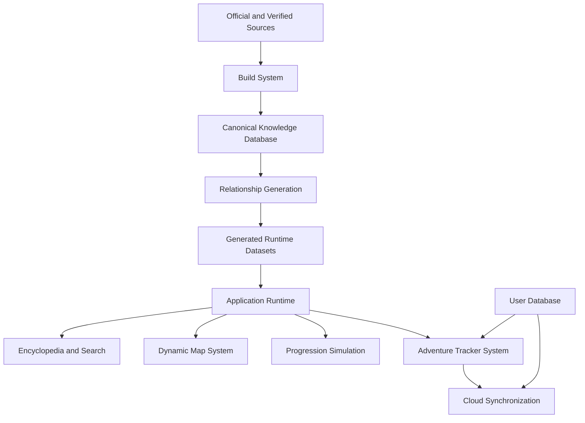
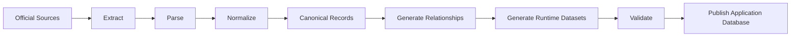
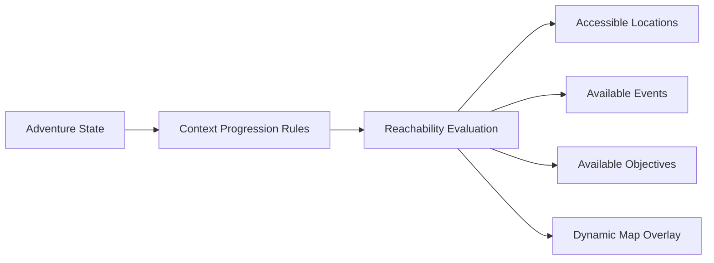

# Pokémon Companion System Architecture

> **System Architecture Specification**
>
> Defines the major systems, boundaries, responsibilities, and interactions that compose Pokémon Companion.

---

## 1. Purpose

Pokémon Companion is an offline-first Pokémon exploration ecosystem that combines:

- A historical Pokémon encyclopedia
- A version-aware game database
- Interactive and dynamic world maps
- Multi-game adventure trackers
- Progression simulation
- Collection and completion tracking
- Research tooling
- Future AI and community features

This document defines the platform architecture at a system level. It describes responsibilities and boundaries rather than prescribing a specific programming language, framework, database engine, or hosting provider.

---

## 2. Architectural Principles

### 2.1 Database-First Development

Pokémon Companion is built around a Pokémon Knowledge System.

The runtime application consumes validated local datasets rather than depending on external APIs for canonical Pokémon information.

```text
Official Sources
        ↓
Raw Extraction
        ↓
Raw Sources
        ↓
Normalization
        ↓
Canonical Knowledge Database
        ↓
Relationship Generation
        ↓
Generated Datasets
        ↓
Validation
        ↓
Runtime Application
```

### 2.2 Official Data First

Source priority is:

1. Official game data, game assets, game text, encounter tables, and event data
2. Verified technical references, ROM research, reverse-engineering projects, and technical documentation
3. Supporting community research

Community sources may supplement gaps but must never override confirmed official information.

### 2.3 Historical Accuracy

Every supported game is an independent historical context.

FireRed data must remain FireRed data. Emerald data must remain Emerald data. Later mechanics must never overwrite earlier mechanics.

Historical differences include:

- Pokémon availability
- Forms
- Types
- Abilities
- Moves
- Learnsets
- Evolution methods
- Encounters
- Trainers
- Items
- World events
- Progression rules
- Map accessibility

### 2.4 Offline First

The encyclopedia, maps, canonical data, and local tracker functionality should remain available without internet access.

Network access is required only for optional services such as:

- Authentication
- Cloud synchronization
- Community features
- AI features
- Dataset updates
- Remote backups

### 2.5 Separation of Systems

Canonical Pokémon knowledge and personal user progress are separate systems.

Canonical data describes the Pokémon world. User data describes a trainer's interaction with that world.

User data may reference canonical records but must never modify them.

---

## 3. High-Level Architecture



The platform is composed of the following primary systems:

1. Pokémon Knowledge System
2. Build System
3. Application Runtime
4. Adventure Tracker System
5. Dynamic Map System
6. Progression Simulation System
7. User Platform and Cloud Synchronization
8. Asset and Exploration System
9. Developer and Glitch Mode System

---

## 4. Pokémon Knowledge System

The Pokémon Knowledge System is the canonical source of official Pokémon information.

It is immutable at runtime and shared by every user.

### 4.1 Responsibilities

The system owns canonical entities including:

- Generations
- Version Groups
- Versions
- Game Contexts
- Regions
- Locations
- Location Areas
- Maps
- Map Tiles
- Species
- Forms
- Pokémon
- Moves
- Abilities
- Items
- Types
- Natures
- Egg Groups
- Evolution Methods
- Machines
- Encounters
- Trainers
- Trainer Parties
- Events
- Pokédex Entries
- Sprites
- Models
- Ribbons
- Marks

### 4.2 Knowledge Graph

Canonical entities are connected through first-class relationships.

```text
Species
 ├── has form → Form
 ├── evolves into → Species
 ├── has type → Type
 └── has ability → Ability

Pokémon
 ├── learns → Move
 ├── appears in → Encounter
 └── belongs to → Game Context

Trainer
 ├── uses → Pokémon
 └── appears in → Map Event

Machine
 ├── teaches → Move
 └── is available in → Game Context

Location
 ├── contains → Encounter
 ├── contains → Map
 ├── contains → Item Event
 └── connects to → Location
```

Relationships store historical metadata where required, including:

- Context
- Version
- Version Group
- Method
- Level
- Probability
- Availability
- Conditions
- Restrictions
- Notes
- Source provenance

---

## 5. Build System

The Build System transforms source material into validated runtime datasets.

It is a development and release tool, not a runtime dependency for ordinary application use.

### 5.1 Responsibilities

- Source extraction
- Asset extraction
- Data parsing
- Normalization
- Canonical record generation
- Relationship generation
- Search index generation
- Asset manifest generation
- Validation
- Build reporting
- Dataset publishing

### 5.2 Build Pipeline



### 5.3 Generated Datasets

Generated datasets are optimized views of canonical data. They are never the source of truth.

Examples include:

- Pokémon lookup tables
- Move lookup tables
- Search indexes
- Autocomplete indexes
- Evolution graphs
- Encounter tables
- Map connection graphs
- Progression requirement indexes
- Relationship indexes
- Completion statistics
- Asset manifests

Generated data must be deterministic, reproducible, and safe to delete and rebuild.

---

## 6. Application Runtime

The Application Runtime provides read-only access to canonical knowledge and controlled access to user data.

### 6.1 Responsibilities

- Search
- Filtering
- Sorting
- Entity navigation
- Context resolution
- Map rendering
- Encounter lookup
- Evolution lookup
- Team analysis
- Damage calculations
- Progression calculations
- User tracker updates
- Local caching
- Offline support

### 6.2 Runtime Services

| Service | Responsibility |
|---|---|
| Pokémon Service | Pokémon, species, forms, moves, abilities, evolutions, and locations |
| World Service | Regions, locations, routes, dungeons, maps, and connections |
| Encounter Service | Wild encounters, fishing, gifts, trades, and version differences |
| Event Service | NPCs, trainers, story events, gifts, hidden items, and world interactions |
| Progression Service | Reachability, objectives, barriers, required conditions, and alternate paths |
| Adventure Service | Tracker state, collection progress, teams, notes, and completion data |
| Asset Service | Sprite, tile, model, icon, badge, and map asset resolution |
| Sync Service | Offline queueing, conflict detection, cloud synchronization, and backup |

---

## 7. Game Context System

A Game Context determines how canonical data is interpreted for a specific game.

```text
Generation
    ↓
Version Group
    ↓
Version
    ↓
Game Context
```

A context controls:

- Available Pokémon and forms
- Available moves and abilities
- Available items and machines
- Encounter tables
- Trainers
- Maps
- Story events
- Progression requirements
- Mechanics
- Evolution rules

A FireRed context and a LeafGreen context may share map geometry while retaining separate version-exclusive encounters, items, trainers, and events.

---

## 8. Adventure Tracker System

The Adventure Tracker System represents a user's personal journey through one game context.

A user may own any number of trackers, including multiple trackers for the same game.

Examples:

```text
My Adventures
 ├── FireRed 100%
 ├── FireRed Nuzlocke
 ├── FireRed Speedrun Route
 ├── Emerald Living Dex
 └── LeafGreen Casual Playthrough
```

### 8.1 Tracker Isolation

Every tracker is completely independent.

Trackers must never share:

- Badges
- HM permissions
- Key items
- Party Pokémon
- Box Pokémon
- Caught Pokémon
- Map exploration
- Collected items
- Defeated trainers
- Event completion
- Notes
- Achievements
- Settings

A FireRed tracker cannot affect a LeafGreen tracker. Two FireRed trackers cannot affect one another.

### 8.2 Adventure State

```json
{
    "id": "tracker:firered-100",
    "userId": "user:krishan",
    "gameContextId": "context:firered",
    "name": "FireRed 100%",
    "mode": "normal",
    "trainerState": {},
    "worldState": {},
    "mapState": {},
    "eventState": {},
    "collectionState": {},
    "achievementState": {},
    "settings": {},
    "createdAt": "2026-08-16T00:00:00Z",
    "updatedAt": "2026-08-16T00:00:00Z"
}
```

### 8.3 Trainer State

Trainer state includes:

- Badges
- HM moves and field permissions
- Key items
- Inventory
- Money
- Party Pokémon
- Box Pokémon
- Completed battles
- Completed events
- Seen, caught, and owned Pokémon
- Ribbons, marks, and collection metadata

### 8.4 World State

World state records changes to the selected game world.

Examples:

- Snorlax defeated or captured
- A Cut tree removed
- A route obstacle cleared
- A hidden item collected
- An NPC interaction completed
- A legendary Pokémon captured
- A story flag completed
- A gym leader defeated

---

## 9. Dynamic Map System

The Dynamic Map System provides an interactive, tile-based representation of a selected game world.

It is designed for map exploration, completion tracking, research, and progression simulation.

### 9.1 Map Capabilities

- Zoom and pan
- Layer visibility
- Tile interaction
- Route and location navigation
- NPC display
- Trainer display
- Item display
- Hidden item display
- Encounter display
- Event display
- Obstacle display
- Completion state display
- Reachability display
- Sprite-based interaction

### 9.2 Map Layers

```text
Map
 ├── Terrain Layer
 ├── Building Layer
 ├── Collision Layer
 ├── Connection Layer
 ├── NPC Layer
 ├── Trainer Layer
 ├── Item Layer
 ├── Hidden Item Layer
 ├── Event Layer
 ├── Obstacle Layer
 └── Tracker Progress Layer
```

### 9.3 Map Object Model

Every interactive object requires a stable canonical identifier.

```json
{
    "id": "event:firered-celadon-eevee",
    "type": "gift-pokemon",
    "gameContextId": "context:firered",
    "mapId": "map:celadon-mansion-roof",
    "position": {
        "x": 12,
        "y": 7
    },
    "requirements": [
        {
            "type": "event",
            "id": "event:firered-meet-evee-owner"
        }
    ],
    "assetId": "sprite:eevee",
    "statusRules": {
        "available": true,
        "completable": true
    }
}
```

### 9.4 Interactive Objects

Users can select map objects to inspect information and update tracker progress.

| Object | Example Actions |
|---|---|
| Pokémon encounter | Mark seen, caught, shiny, or researched |
| Item | Mark collected or ignored |
| Hidden item | Mark discovered or collected |
| Trainer | Mark defeated, rematch available, or incomplete |
| NPC | Mark spoken to or event completed |
| Obstacle | View blocking requirement |
| Gift Pokémon | Mark available, received, or declined |
| Story event | View requirements and completion status |

---

## 10. Progression Simulation System

The Progression Simulation System determines what is reachable in a selected Game Context.

It must model a dependency graph, not a fixed walkthrough.

### 10.1 Core Principle

The system should answer:

> Given this game context and this tracker state, what can the player currently access?

It must support:

- Intended routes
- Legitimate alternate routes
- Optional areas
- Player-selected gym order
- Sequence breaks available through normal gameplay
- Hypothetical progress previews
- Developer-mode glitch routes

### 10.2 Progression Inputs

- Game Context
- Badge ownership
- HM possession
- HM field permissions
- Key items
- Story flags
- Event completion
- Captured or defeated world Pokémon
- Developer-mode settings
- Enabled glitches

### 10.3 Progression Graph



Each map connection, obstacle, event, and objective has explicit requirements.

```json
{
    "id": "connection:firered-route-7-saffron-gate",
    "fromLocationId": "location:route-7",
    "toLocationId": "location:saffron-city",
    "requirements": [
        {
            "type": "key-item",
            "id": "item:tea"
        }
    ]
}
```

### 10.4 FireRed Example

FireRed progression must not be represented as a mandatory numeric gym sequence.

The application should evaluate conditions such as:

- Badge requirements for field move use
- Cut trees
- Surf routes
- Snorlax obstacles
- Poké Flute access
- Saffron gate access through Tea
- Silph Co. story progression
- Gym-specific access rules
- Optional paths through Rock Tunnel, Lavender Town, Celadon City, and Fuchsia City

The interface may show recommended routes, but recommendations must never replace the underlying dependency graph.

### 10.5 Progress Preview Mode

Progress Preview Mode allows users to simulate a hypothetical state without changing a tracker.

```text
Game: FireRed
Badges: Boulder, Cascade
Field Moves: Cut
Key Items: Tea
Story Events: Bill rescued

Result:
- Newly reachable locations
- Newly available encounters
- Newly available trainers
- Newly available items
- Newly available objectives
```

Simulation state and saved tracker state must remain separate.

---

## 11. Normal Mode and Developer Mode

### 11.1 Normal Mode

Normal Mode is the default experience.

It supports:

- Intended game mechanics
- Legitimate alternate progression
- Optional areas
- Standard sequence breaks possible without glitches
- Context-accurate restrictions

### 11.2 Developer Mode

Developer Mode is an opt-in advanced system.

It supports:

- Verified glitches
- Glitch-assisted routes
- Debug world states
- Forced event states
- Test HM permissions
- Full map previews
- Experimental route planning

Developer Mode must visibly distinguish glitch-assisted results from normal progression results.

### 11.3 Glitch Records

```json
{
    "id": "glitch:firered-cut-tree-phase",
    "gameContextId": "context:firered",
    "name": "Cut Tree Phase",
    "description": "A verified glitch route that bypasses a normal map barrier.",
    "difficulty": "advanced",
    "risk": "medium",
    "affectedMapIds": [],
    "requirements": [],
    "instructions": [],
    "verificationStatus": "verified"
}
```

Glitch routes must never be enabled automatically.

---

## 12. User Platform and Cloud Synchronization

The User Platform owns mutable personal information.

### 12.1 Responsibilities

- Accounts
- Authentication
- Profiles
- Adventure trackers
- Teams
- Collections
- Notes
- Achievements
- Preferences
- Local storage
- Cloud synchronization
- Backup and recovery

### 12.2 Offline Synchronization

```text
Offline Device
    ↓
Local Tracker Changes
    ↓
Persistent Sync Queue
    ↓
Internet Restored
    ↓
Authenticated Synchronization
    ↓
Cloud Backup Updated
```

### 12.3 Conflict Handling

Sync must merge independent changes when possible.

Examples:

- One device marks an item collected
- Another device marks a trainer defeated

Both changes can be merged.

Conflicts involving the same field should use:

1. Deterministic merge rules
2. Timestamps and version metadata
3. User confirmation when automatic resolution is unsafe

Tracker isolation remains mandatory during synchronization.

---

## 13. Asset System

The Asset System provides context-aware references to visual resources.

Assets include:

- Pokémon sprites
- Form sprites
- Item sprites
- NPC sprites
- Trainer sprites
- Map tiles
- Map objects
- Badges
- Medals
- Icons
- Models
- Animations

Assets must be referenced by stable identifiers rather than hard-coded file paths.

```text
asset:pokemon:charizard:front-default
asset:item:master-ball
asset:trainer:firered-brock
asset:map-tile:firered-pallet-town-grass
```

The Asset System must support offline packaging and context-specific variants.

---

## 14. Exploration and Achievement System

The exploration system provides DexNav-inspired discovery and completion tracking.

### 14.1 Exploration Categories

- Routes
- Cities
- Caves
- Buildings
- Map areas
- Pokémon encounters
- Trainers
- Items
- Hidden items
- NPC interactions
- Story events

### 14.2 Achievement Categories

| Category | Examples |
|---|---|
| Exploration | Visit every route, city, cave, or map area |
| Collection | Complete a Pokédex, collect items, earn ribbons |
| Trainer | Defeat trainers, complete gyms, become Champion |
| Research | Discover encounters, document hidden items, complete data |
| Adventure | Complete story milestones and optional quests |

Achievements reference tracker state and canonical requirements. They do not modify canonical data.

---

## 15. Frontend Architecture

The frontend is the interaction layer of Pokémon Companion.

### 15.1 Main Areas

- Pokédex
- Move Dex
- Ability Dex
- Item Dex
- Location Explorer
- Encounter Explorer
- Evolution Explorer
- Dynamic Map
- Adventure Dashboard
- Tracker Manager
- Collection Manager
- Achievement Center
- Settings
- Developer Mode

### 15.2 Adventure Dashboard

A dashboard should show the current state of one selected tracker.

```text
FireRed 100%

Current Location: Celadon City
Badges: Boulder, Cascade
Current Team: Charizard, Pikachu, Lapras
Available Objectives: Explore Celadon Gym, obtain Tea
Map Completion: 42%
Collection Completion: 118 / 151
```

### 15.3 Tracker Manager

The tracker manager must allow a user to create, rename, archive, duplicate, export, and switch between trackers without any shared progression state.

---

## 16. Security and Data Integrity

### 16.1 Rules

1. Users may access only their own trackers and personal data.
2. Canonical knowledge data is read-only at runtime.
3. User data references canonical identifiers.
4. Cloud synchronization requires authentication.
5. Tracker records must remain isolated.
6. Deleted user data should support recovery where practical.
7. Generated datasets must pass validation before publication.

### 16.2 Reference-Based User Data

User records should reference canonical entities rather than duplicate them.

```json
{
    "speciesId": "species:pikachu",
    "nickname": "Spark",
    "level": 25,
    "natureId": "nature:timid",
    "abilityId": "ability:static",
    "shiny": false
}
```

This keeps user data small, stable, and compatible with canonical dataset updates.

---

## 17. Future Systems

The architecture reserves space for future capabilities.

### 17.1 AI Companion System

Potential features:

- Team recommendations
- Context-aware progression guidance
- Location suggestions
- Collection planning
- Battle analysis
- Research assistance

AI features must consume validated canonical data and respect tracker isolation.

### 17.2 Save Import System

Potential features:

- Emulator save import
- Progress detection
- Party detection
- Item detection
- Tracker reconciliation
- Optional auto-completion suggestions

### 17.3 OCR Recognition System

Potential features:

- Screenshot scanning
- Pokémon recognition
- Menu recognition
- Progress recognition
- Encounter recognition

### 17.4 Community System

Potential features:

- Shared routes
- Challenges
- Completion rankings
- Research contributions
- Speedrun strategies

Community content must remain separate from official canonical data.

---

## 18. Development Rules

Every system must follow these rules:

- Prefer data-driven behavior over hard-coded logic.
- Use stable identifiers for every entity and relationship.
- Keep canonical data separate from user data.
- Preserve historical contexts.
- Validate references and requirements.
- Support offline use where possible.
- Add new games through datasets, contexts, assets, and rules rather than architectural rewrites.
- Treat maps, events, progression rules, and relationships as first-class data.

---

## 19. Final Architecture Summary

```text
Official and Verified Sources
            ↓
        Build System
            ↓
Canonical Knowledge Database
            ↓
Relationship Generation and Validation
            ↓
Generated Offline Runtime Datasets
            ↓
Application Runtime
      ┌─────┼─────┐
      ↓     ↓     ↓
Pokédex  Maps  Progression Simulation
                    ↓
             Adventure Tracker System
                    ↓
          User Database and Cloud Sync
```

Pokémon Companion is designed as a scalable, historically accurate, offline-capable Pokémon platform.

It provides a foundation for encyclopedic research, dynamic map exploration, multiple independent adventures, version-aware progression simulation, personal collection tracking, and future intelligent companion features.